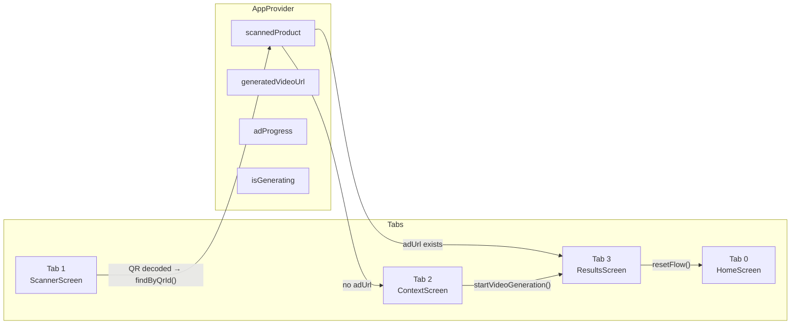

# AdForge — Frontend (Flutter Mobile Application)

The Flutter mobile application provides the user-facing interface for AdForge. It handles QR code scanning, product identification, backend communication, and video advertisement playback.

---

## Architecture Overview

The app uses a four-tab `PageView` layout with centralised state management via the `provider` package. Navigation between tabs is controlled programmatically by `AppProvider`, and manual swiping is disabled.



### Tab Descriptions

| Tab | Screen | Purpose |
|-----|--------|---------|
| Home | `HomeScreen` | Dashboard with branding, "Scan QR Code" button, and recent activity log |
| Scan | `ScannerScreen` | Real-time camera QR scanner using `mobile_scanner` |
| Context | `ContextScreen` | Marketing context input for AI generation path (not used in production flow) |
| Results | `ResultsScreen` | 8-second anticipation animation followed by video playback |

---

## QR Scanning and Product Identification

### Scanner Implementation

The `ScannerScreen` uses the `mobile_scanner` package to decode QR codes via the device camera. Key behaviours:

- **Exact matching:** `Product.findByQrId(barcodeValue)` performs a strict equality check against the centralised product catalogue.
- **No fallback:** Unknown QR codes display a red error snackbar. The app never falls back to another product's advertisement.
- **Duplicate guard:** A `_isProcessing` flag prevents concurrent scan handlers.

### Product Catalogue

Defined in `lib/models/product.dart`. Each product entry contains:

```dart
Product(
  id: 'PROD-S24ULTRA',          // QR identifier (exact match)
  name: 'Galaxy S24 Ultra',
  brand: 'Samsung',
  category: 'Smartphone',
  description: '...',
  features: ['...'],
  imageUrl: '',
  price: 1299.99,
  adUrl: 'https://adforge.s3.ap-south-1.amazonaws.com/ads/s24.mp4',
)
```

The `adUrl` field determines the routing: if present, the app skips the Context screen and routes directly to ad playback.

---

## Anticipation and Playback Flow

When a product with a pre-uploaded ad is identified:

1. `AppProvider.playProductAd()` is called.
2. The app navigates to the Results tab and shows the `InteractiveLoadingWidget`.
3. A `Timer.periodic` (80ms interval) drives a progress bar from 0% to 100% over 8 seconds.
4. In parallel, `ApiService.getAdVideoUrl()` fetches a presigned S3 URL from the backend.
5. Status text updates at 30%, 60%, and 90% milestones.
6. When both the timer completes and the URL is available, `_generatedVideoUrl` is set, the loading state ends, and the video player initialises.
7. If the URL fetch fails, an error screen is displayed.

### Video Player

- Uses the `video_player` package with `VideoPlayerController.networkUrl`.
- Auto-plays and loops on initialisation.
- Tap-to-pause/play with animated opacity overlay.
- Dynamic aspect ratio based on video dimensions.
- Error state displayed if initialisation fails.

### Download and Share

| Feature | Package | Behaviour |
|---------|---------|-----------|
| Download | `dio` + `gal` | Downloads MP4 to temp, saves to gallery under "Ad-Forge" album |
| Share | `dio` + `share_plus` | Downloads MP4 to temp, opens native share sheet |

Both actions show loading spinners and handle errors with snackbar notifications.

---

## State Management

`AppProvider` (a `ChangeNotifier`) manages all application state:

| Property | Type | Purpose |
|----------|------|---------|
| `scannedProduct` | `Product?` | Currently identified product |
| `generatedVideoUrl` | `String?` | Presigned URL for video playback |
| `isGenerating` | `bool` | Whether anticipation/loading is active |
| `adProgress` | `double` | 0.0–1.0 progress for anticipation bar |
| `generationStatus` | `String` | Current status text |
| `error` | `String?` | Error message if playback setup failed |
| `recentActivities` | `List<ActivityItem>` | Last 5 activity entries for dashboard |

---

## API Communication

`ApiService` in `lib/services/api_service.dart` handles all backend calls:

| Method | Endpoint | Purpose |
|--------|----------|---------|
| `getAdVideoUrl(productId)` | `GET /products/{id}/advertisement` | Fetch presigned S3 URL |
| `startVideoGenerationJob(product, context)` | `POST /forge` | Start AI generation job |
| `checkJobStatus(jobId)` | `GET /status/{jobId}` | Poll job status |

The API base URL is configured as:
```dart
static const String _baseUrl =
    'https://<api-id>.execute-api.ap-south-1.amazonaws.com/Prod';
```

---

## Project Structure

```
frontend/lib/
├── main.dart                  # Entry point, MaterialApp, PageView navigation
├── models/
│   └── product.dart           # Product, AdResult, ProductInfo data models
├── providers/
│   └── app_provider.dart      # Central state management (ChangeNotifier)
├── screens/
│   ├── home_screen.dart       # Dashboard with activity feed
│   ├── scanner_screen.dart    # QR code scanner
│   ├── context_screen.dart    # Marketing context input
│   └── results_screen.dart    # Loading animation + video player
├── services/
│   └── api_service.dart       # Backend API client
├── theme/
│   └── app_theme.dart         # Dark theme configuration
└── widgets/
    └── loading_animation.dart # InteractiveLoadingWidget, FlyingCharacterWidget
```

---

## Dependencies

Listed in `pubspec.yaml`:

```yaml
dependencies:
  flutter: sdk
  provider: ^6.1.2
  mobile_scanner: ^5.1.0
  video_player: ^2.8.6
  http: ^0.13.6
  dio: ^5.4.3
  gal: ^2.3.0
  share_plus: ^9.0.0
  path_provider: ^2.1.3
  image_picker: ^1.1.2
  permission_handler: ^12.0.1
  cupertino_icons: ^1.0.2
```

---

## Build Instructions

### Development

```bash
cd frontend/
flutter pub get
flutter run
```

### Release APK

```bash
flutter build apk --release
# Output: build/app/outputs/flutter-apk/app-release.apk
```

### iOS

```bash
flutter build ios --release
```

### Static Analysis

```bash
flutter analyze
```

---

## Configuration

Before running, ensure the API base URL in `lib/services/api_service.dart` matches your deployed API Gateway endpoint. No API keys or AWS credentials are stored in the Flutter application.
